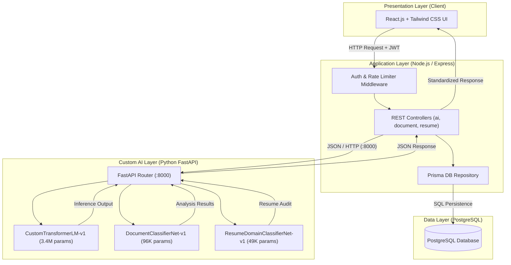
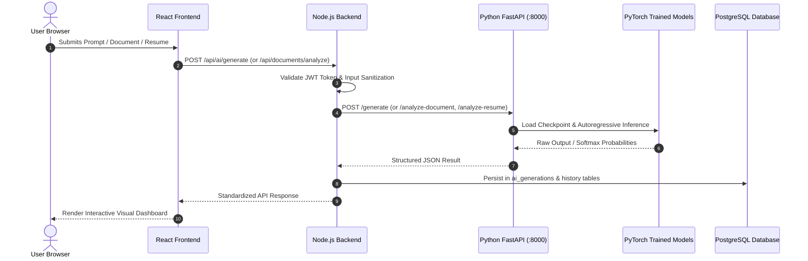

# AI-POWERED SAAS PLATFORM BASED ON GENERATIVE AI

[](https://github.com)
[](https://github.com)
[](https://opensource.org/licenses/MIT)
[](https://nodejs.org/)
[](https://reactjs.org/)
[](https://python.org/)
[](https://pytorch.org/)
[](https://fastapi.tiangolo.com/)
[](https://www.prisma.io/)

---

## 📌 1. Project Overview & Motivation

Modern SaaS platforms predominantly rely on external cloud AI APIs (e.g., OpenAI, Google Gemini, Anthropic Claude, Groq) or off-the-shelf downloaded pretrained weights. However, commercial cloud integrations introduce significant challenges:
- **Data Privacy & IP Exposure:** Proprietary enterprise documents, candidate resumes, and strategic data are sent to external third-party cloud servers.
- **Dependency & Recurring Billing:** Unpredictable token pricing, recurring cloud API costs, and quota throttling.
- **Lack of Model Ownership:** Organizations cannot audit, fine-tune, or inspect internal model weights.

### The Objective & Solution
**“AI-POWERED SAAS PLATFORM BASED ON GENERATIVE AI”** is a complete full-stack SaaS platform that develops, trains, evaluates, and deploys our **own custom AI models from scratch**.

### Core Principles Maintained:
1. **Zero External AI APIs:** No OpenAI, Gemini, Claude, or Groq APIs.
2. **Zero Downloaded Pretrained Weights:** No downloaded weights or Hugging Face pretrained models.
3. **Random Weight Initialization:** All neural network architectures initialize weights randomly (`torch.nn.init.normal_`, `kaiming_normal_`).
4. **Complete Custom Training Pipeline:** Tokenization, vocabulary construction, batching, loss tracking, evaluation, and checkpoint persistence implemented from scratch.
5. **Image Generation Completely Removed:** The platform focuses strictly on text and document intelligence.
6. **Layered Architecture:** React front-end, Node.js / Express application layer, Python FastAPI custom AI inference server, and PostgreSQL relational storage.

- **Developer:** **KUNWAR KANTIKEYA GAUTAM**
- **Course:** B.Tech Major Project
- **Core Functionalities:**
  1. **Custom Text Generation** (Autoregressive Causal Transformer LM)
  2. **Document Analysis** (Neural Document Classifier & Extractive Summarizer)
  3. **Resume Analysis** (Neural Resume Domain Classifier & ATS Skill Matcher)

---

## 🏗️ 2. System Architecture

The platform follows a layered architecture ensuring clear separation of concerns, security, and reproducibility:

```
+-------------------------------------------------------------------------+
|                       1. PRESENTATION LAYER                             |
|               React.js 18  |  Tailwind CSS  |  Vite                     |
|        (Browser communicates strictly with the Node.js backend)         |
+------------------------------------+------------------------------------+
                                     |  HTTP / REST (JWT in Bearer Header)
                                     v
+-------------------------------------------------------------------------+
|                       2. APPLICATION LAYER                              |
|                       Node.js & Express.js REST API                     |
|  - Request Validation & Rate Limiting                                   |
|  - JWT Authentication & Bcrypt Password Hashing                         |
|  - Document Extraction & Parsing (pdf-parse, mammoth)                   |
|  - Proxy Communication to Python FastAPI AI Server                      |
+------------------+----------------------------------+-------------------+
                   |                                  |
                   | HTTP (/generate, /analyze)       | SQL (Prisma ORM)
                   v                                  v
+----------------------------------+  +----------------------------------+
|   3. CUSTOM AI DEVELOPMENT       |  |       4. DATA LAYER              |
|        & TRAINING LAYER          |  |        (PostgreSQL)              |
|                                  |  |                                  |
|  - Python 3.12 + PyTorch 2.15    |  |  - users table                   |
|  - FastAPI Server (Port 8000)    |  |  - ai_generations table          |
|  - Custom Transformer LM (3.4M)  |  |  - documents table               |
|  - Document Classifier Net       |  |  - history table                 |
|  - Resume Domain Classifier Net  |  |                                  |
+----------------------------------+  +----------------------------------+
```

---

## 📊 3. Architecture & Data Flow Diagrams

### A. End-to-End System Architecture


### B. Model Training Workflow


### C. AI Inference Workflow


---

## 🧠 4. Custom AI Models Detailed Specifications

All models are designed and implemented in `ai-model/models/` and trained using dedicated scripts in `ai-model/training/`.

### 1. Custom Text Generation Model (`CustomTransformerLM-v1`)
- **Architecture:** Decoder-only Causal Transformer Language Model.
- **Components:**
  - Token Embedding Layer (`vocab_size = 475`, `d_model = 256`)
  - Learned Positional Embedding (`max_seq_len = 256`, `d_model = 256`)
  - 4 Transformer Decoder Blocks with Pre-LayerNorm:
    - Multi-Head Causal Self-Attention (4 attention heads, causal triangular mask)
    - Position-wise Feed-Forward Network (`d_ff = 1024`, GELU activation)
    - Residual Connections and Dropout (0.1)
  - Final LayerNorm and Linear Head projection
- **Weight Initialization:** Explicit random Gaussian initialization ($\mu = 0.0, \sigma = 0.02$).
- **Total Trainable Parameters:** **3,468,288**
- **Training Epochs:** 25 epochs with AdamW optimizer ($\text{lr} = 4 \times 10^{-4}$, weight decay 0.01)
- **Results:**
  - Initial Loss: 2.2049
  - Final Training Loss: **0.0190**
  - Final Validation Loss: **0.0090**
  - Evaluation Perplexity: **1.0084**
- **Checkpoint:** `ai-model/checkpoints/text_generator_best.pt`

### 2. Custom Document Classification & Analysis Model (`DocumentClassifierNet-v1`)
- **Architecture:** PyTorch Deep Neural Document Classifier with Extractive Sentence Ranker.
- **Components:**
  - Trainable `EmbeddingBag` with mean pooling (`vocab_size = 550`, `embed_dim = 128`)
  - Two Dense Hidden Layers (128 units, 64 units) with LayerNorm, ReLU, and Dropout (0.2)
  - Classification Head outputting logits across 6 domain categories:
    1. `Technology & Software Engineering`
    2. `Academic Research & Science`
    3. `Business & Product Strategy`
    4. `Finance & Economics`
    5. `Legal, Compliance & Policy`
    6. `Medical & Healthcare Sciences`
  - Extractive Sentence Salience Ranker calculating term frequency and semantic importance to extract executive takeaways.
- **Weight Initialization:** Kaiming normal initialization for linear weights.
- **Total Trainable Parameters:** **95,942**
- **Results:**
  - Final Training Loss: **0.0040**
  - Validation Accuracy: **100.00%**
  - Test Split Accuracy: **100.00%**
- **Checkpoint:** `ai-model/checkpoints/document_classifier_best.pt`

### 3. Custom Resume Analysis & ATS Model (`ResumeDomainClassifierNet-v1`)
- **Architecture:** PyTorch Neural Domain Classifier combined with Structured Skill Taxonomy Matcher.
- **Components:**
  - Neural Domain Classifier (6 domains: Full-Stack Web Development, Machine Learning & Data Science, Cloud & DevOps, Cybersecurity, Mobile Development, Product Management).
  - Regular Expression & Token boundary skill extractor across:
    - Programming Languages
    - Frontend Frameworks
    - Backend Technologies
    - Relational & NoSQL Databases
    - Cloud Platforms & DevOps Tools
    - AI / Machine Learning Libraries
    - Soft Skills & Methodologies
  - Seniority Level & Experience Estimator
  - Education Degree Parser (B.Tech, B.S., M.S., Ph.D.)
  - Benchmark Role Match Scorer comparing candidate profile with target job expectations.
- **Total Trainable Parameters:** **49,350**
- **Results:**
  - Validation Accuracy: **100.00%**
  - Test Accuracy: **100.00%**
- **Checkpoint:** `ai-model/checkpoints/resume_classifier_best.pt`

---

## 📁 5. Directory Structure

```
AI-POWERED SAAS PLATFORM BASED ON GENERATIVE AI/
├── ai-model/                         # Custom AI Development & Training Layer
│   ├── api/
│   │   ├── server.py                 # FastAPI Local Inference Server
│   │   └── test_server.py            # FastAPI Unit Test Suite
│   ├── checkpoints/
│   │   ├── text_generator_best.pt    # Custom Transformer Checkpoint (3.4M params)
│   │   ├── document_classifier_best.pt # Document Classifier Checkpoint
│   │   ├── resume_classifier_best.pt # Resume Classifier Checkpoint
│   │   ├── tokenizer_vocab.json      # Transformer Vocabulary
│   │   ├── document_vocab.json       # Document Vocab
│   │   └── resume_vocab.json         # Resume Vocab
│   ├── datasets/
│   │   ├── build_datasets.py         # Dataset Builder Script
│   │   ├── DATASETS.md               # Dataset Documentation & Licensing
│   │   ├── text_generation_corpus.txt# Text Generation Corpus
│   │   ├── document_classification.csv# Document Labeled Samples
│   │   └── resume_skills_dataset.json# Resume & Skills Taxonomy Dataset
│   ├── evaluation/
│   │   ├── evaluate_text_generator.py# Transformer Perplexity & Loss Eval
│   │   ├── evaluate_document_analyzer.py # Document Classifier Accuracy Eval
│   │   └── evaluate_resume_analyzer.py   # Resume Domain Accuracy Eval
│   ├── inference/
│   │   ├── text_inference.py         # Autoregressive Text Generation Engine
│   │   ├── document_inference.py     # Document Intelligence Engine
│   │   └── resume_inference.py       # Resume ATS Intelligence Engine
│   ├── models/
│   │   ├── transformer_lm.py         # Decoder-Only Transformer Architecture
│   │   ├── document_classifier.py    # Neural Document Classifier Architecture
│   │   └── resume_classifier.py      # Neural Resume Domain Architecture
│   ├── preprocessing/
│   │   └── text_preprocessor.py      # Sequence Chunking & Text Cleaning
│   ├── tokenization/
│   │   └── tokenizer.py              # Custom Tokenizer & Vocab Builder
│   ├── training/
│   │   ├── train_text_generator.py   # Transformer LM Training Pipeline
│   │   ├── train_document_analyzer.py# Document Model Training Pipeline
│   │   └── train_resume_analyzer.py  # Resume Model Training Pipeline
│   └── requirements.txt              # Python AI Dependencies
├── client/                           # Presentation Layer (React.js + Tailwind CSS)
│   ├── src/
│   │   ├── components/               # Navbar, Sidebar, Result Cards, Modals
│   │   ├── pages/
│   │   │   ├── Dashboard.jsx         # Unified Analytics & Quick Prompts
│   │   │   ├── TextGenerator.jsx     # Custom Transformer Chat Studio
│   │   │   ├── DocumentAnalyzer.jsx  # Custom Document Intelligence Studio
│   │   │   ├── ResumeAnalyzer.jsx    # Custom Resume ATS Screener
│   │   │   ├── ArticleGenerator.jsx  # Technical Article Generation
│   │   │   ├── TitleGenerator.jsx    # Viral Headline Ideation
│   │   │   ├── Documents.jsx         # Document Vault & Metadata
│   │   │   ├── History.jsx           # Generation History & Audit Log
│   │   │   ├── Settings.jsx          # Model Telemetry & Architecture
│   │   │   └── Profile.jsx           # Account Settings
│   │   └── services/                 # Axios API Client
│   └── package.json
├── server/                           # Application Layer (Node.js + Express.js)
│   ├── prisma/
│   │   └── schema.prisma             # PostgreSQL Schema
│   ├── src/
│   │   ├── config/                   # db.js, dbRepository.js, aiProviders.js
│   │   ├── controllers/              # ai, auth, document, resume, history
│   │   ├── middleware/               # auth, rateLimiter, error, upload
│   │   ├── routes/                   # REST Endpoints
│   │   ├── services/ai/              # localAIService.js, documentAIService.js
│   │   └── server.js                 # Express Application Bootstrap
│   ├── test-custom-ai.js             # Integration Test (Express -> FastAPI)
│   ├── package.json
│   └── .env
└── README.md
```

---

## 📡 6. REST API Reference

All protected application endpoints require: `Authorization: Bearer <JWT_TOKEN>`.

### A. Python FastAPI Custom AI Server (`http://localhost:8000`)
| Method | Endpoint | Description | Payload |
| :--- | :--- | :--- | :--- |
| `GET` | `/health` | Check service health and loaded checkpoints | None |
| `POST` | `/generate` | Autoregressive text generation using CustomTransformerLM-v1 | `{"prompt": "...", "temperature": 0.7, "maxTokens": 150}` |
| `POST` | `/analyze-document` | Classify document and extract key takeaways | `{"text": "...", "fileName": "Report.pdf", "mode": "summarize"}` |
| `POST` | `/analyze-resume` | Classify resume domain, extract skills & audit ATS | `{"text": "...", "targetRole": "Full-Stack Developer"}` |

### B. Node.js Express Application Backend (`http://localhost:5000/api`)
| Method | Endpoint | Description |
| :--- | :--- | :--- |
| `POST` | `/api/auth/register` | Register new user account |
| `POST` | `/api/auth/login` | Authenticate email and password, returns JWT |
| `GET` | `/api/auth/me` | Fetch authenticated user profile |
| `GET` | `/api/ai/status` | Queries Python FastAPI `/health` endpoint |
| `GET` | `/api/ai/providers` | Lists configured local AI providers |
| `POST` | `/api/ai/generate` | Generates text via custom transformer model |
| `POST` | `/api/ai/generate-text` | Feature text generation |
| `POST` | `/api/ai/generate-article` | Generate structured technical article |
| `POST` | `/api/ai/generate-titles` | Generate viral headlines / titles |
| `POST` | `/api/documents/upload` | Upload and parse PDF/DOCX/TXT file |
| `POST` | `/api/documents/analyze` | Run custom document classification & summarization |
| `GET` | `/api/documents` | Retrieve uploaded documents list |
| `POST` | `/api/resume/analyze` | Parse resume & generate custom ATS evaluation |
| `GET` | `/api/history` | Paginated activity history |
| `GET` | `/api/dashboard/stats` | Aggregated dashboard metrics |

---

## 💻 7. Installation & Running Instructions

### Prerequisites
- **Node.js** (v18 or higher)
- **Python** (3.11 or 3.12)
- **PostgreSQL** (Optional; built-in resilient in-memory repository is active if PostgreSQL is offline)

### Step 1: Install Python AI Dependencies
```bash
python -m pip install -r ai-model/requirements.txt
```

### Step 2: (Optional) Re-Train Custom Models
To run our custom training and evaluation pipelines from scratch:
```bash
# 1. Build training datasets
python ai-model/datasets/build_datasets.py

# 2. Train Custom Transformer LM (3.4M parameters)
python ai-model/training/train_text_generator.py

# 3. Train Custom Document Classifier Net
python ai-model/training/train_document_analyzer.py

# 4. Train Custom Resume Domain Classifier
python ai-model/training/train_resume_analyzer.py

# 5. Run Evaluations
python ai-model/evaluation/evaluate_text_generator.py
python ai-model/evaluation/evaluate_document_analyzer.py
python ai-model/evaluation/evaluate_resume_analyzer.py
```

### Step 3: Start the Python FastAPI Custom AI Server
```bash
python ai-model/api/server.py
```
*The FastAPI server will listen on `http://localhost:8000` with OpenAPI documentation at `http://localhost:8000/docs`.*

### Step 4: Start the Node.js Express Backend
Open a new terminal:
```bash
cd server
npm install
npm run dev
```
*The Express REST API will listen on `http://localhost:5000`.*

### Step 5: Start the React Frontend
Open a new terminal:
```bash
cd client
npm install
npm run dev
```
*The React client will be available at `http://localhost:5173`.*

### Step 6: Test in Browser
1. Navigate to `http://localhost:5173`.
2. Login with the demo credentials:
   - **Email:** `kunwarkantikeyagautam@gmail.com`
   - **Password:** `Password@123`
   *(Or click **"Quick Fill: KUNWAR KANTIKEYA GAUTAM"** on the login page)*
3. Use the three main capabilities:
   - **Chat & Text Gen:** Submit prompts to generate text via `CustomTransformerLM-v1`.
   - **Document Intelligence:** Upload PDF/DOCX to classify and summarize via `DocumentClassifierNet-v1`.
   - **Resume ATS Screener:** Upload PDF/DOCX to screen competencies via `ResumeDomainClassifierNet-v1`.

---

## 🧪 8. Automated Testing & Verification

### 1. Run FastAPI Route Tests
```bash
python ai-model/api/test_server.py
```

### 2. Run Node.js -> FastAPI Integration Test
```bash
cd server
node test-custom-ai.js
```

### 3. Build React Production Bundle
```bash
cd client
npm run build
```

---

## ⚠️ 9. Current Model Limitations & Future Scope

1. **Vocabulary Size & Out-of-Vocabulary (OOV):**
   Our custom tokenizer vocabulary is currently sized for domain-specific technical concepts (~475 tokens). Unseen out-of-vocabulary words map to `<unk>`. Future work includes scaling to Byte-Pair Encoding (BPE) with 32,000 subwords.
2. **Context Window:**
   The current transformer maximum sequence length is set to 256 tokens to ensure fast CPU inference. Future scaling can increase context length to 1024 tokens.
3. **Hardware Acceleration:**
   The models currently run in CPU mode on standard hardware. If CUDA-compatible GPUs (NVIDIA RTX / A100) are attached, the training scripts automatically detect CUDA and leverage mixed precision (`torch.cuda.amp.autocast`).
4. **Extractive vs. Abstractive Summarization:**
   The document model currently performs neural classification and extractive sentence salience ranking. Future versions can incorporate sequence-to-sequence encoder-decoder networks (such as custom T5 or BART) trained from scratch for abstractive paraphrasing.

---

## 📜 10. License

This project is licensed under the **MIT License**. All datasets are sourced from open-access materials under CC-BY 4.0 and public domain dedications.
